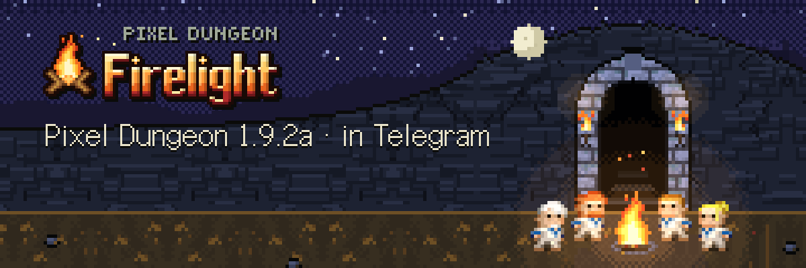
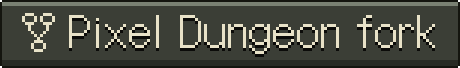
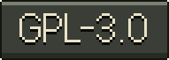
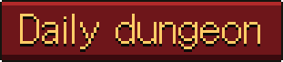

<p align="right"><b>English</b> · <a href="README.ru.md">Русский</a></p>

<p align="center"></p>

<p align="center">
  <a href="https://t.me/pixel_dungeon_gamebot"></a>
  <a href="https://github.com/watabou/pixel-dungeon"></a>
  <a href="LICENSE"></a>
  
</p>

# Pixel Dungeon: Firelight

**Firelight** is a fork of [Pixel Dungeon](https://github.com/watabou/pixel-dungeon) by Watabou, rebuilt for Telegram. Every run starts at the camp fire on the surface; below lies the original dungeon, now lit by firelight.

- **Play:** [@pixel_dungeon_gamebot](https://t.me/pixel_dungeon_gamebot) in Telegram.
- **Base:** the original Pixel Dungeon 1.9.2a. The rules are ported faithfully, with the same four heroes, items, monsters and bosses. Firelight is the polished vanilla: no stack of extra items. New ideas will arrive one at a time, each redone our own way.

## What Firelight adds
- **Fair daily dungeon.** One dungeon for everyone each day, one attempt that counts. The daily seed is a server secret, so nobody can scout it ahead.
- **Server-checked runs.** The server replays every run from the player's moves. A death can't be undone by reloading, and edits on the device are rolled back. Runs fill the daily, weekly and all-time boards, with cups for the top places and a day streak with freezes.
- **The camp.** The home screen is your hero sitting by the fire.
- **A modern touch interface:**
  - a smart camera that keeps your view while you walk;
  - a confirmation before you step on a known trap or drink an unknown potion with an enemy in view;
  - a quick slot tapped twice fires at the marked target;
  - an in-game guide to the original's hidden rules.
- **Coming next:** a lit HD-2D world in Three.js, where torches, fire and magic cast real light and shadow, with voxel heroes and monsters built from the original pixel art. Also our own soundtrack and sounds, and the hero's foul-mouthed one-liners after a kill.

## Repository and branches
- **`main`:** Firelight, a **complete rewrite in TypeScript** of the original Java game. It has three parts:
  - a deterministic rules core;
  - a web client, which is the Telegram Mini App;
  - a server on Cloudflare Workers.
- **`master`:** Watabou's original **Java** source, untouched, kept as the point of origin.

| Folder | What it is |
| --- | --- |
| `packages/core` | The whole game as pure, deterministic TypeScript. The world is plain JSON with integer maths only, so the phone and the server always agree. |
| `packages/client` | The Mini App: the map on a canvas, and the windows, HUD and camp in HTML (design system in `docs/design/system`). |
| `packages/server` | A Cloudflare Worker with one Durable Object per player and per board. It handles Telegram login, replays runs, and runs the boards, mail and problem reports. |

```bash
npm install
npm test            # vitest
npm run typecheck
npm run server      # the server on http://127.0.0.1:8787
npm run dev         # the client on http://127.0.0.1:5173
```

Deployment notes are in [DEPLOY.md](DEPLOY.md).

## Credits and license
Pixel Dungeon is by Watabou (Oleg Dolya), GPL-3.0. Firelight follows the original's rules and uses its art; it is distributed under GPL-3.0-or-later (see [LICENSE](LICENSE)).

An earlier edition of this project on Shattered Pixel Dungeon content (Evan Debenham, GPL-3.0) is kept on the branch `archive/shattered-2.4` of [the previous repository](https://github.com/shiba-vibecoding/pixel-dungeon-telegram).

The interface art (camp, windows, icons) comes from the project's own «Pixel Dungeon UI» design system. The Galmuri font is under SIL OFL 1.1.
