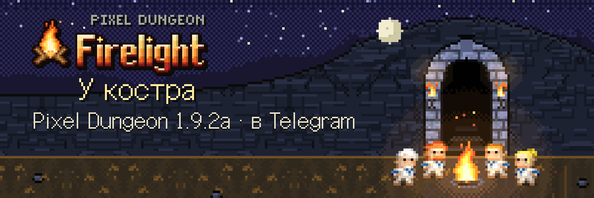
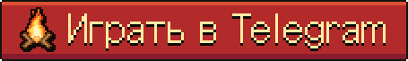
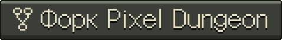
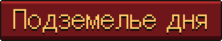

<p align="right"><a href="README.md">English</a> · <b>Русский</b></p>

<p align="center"></p>

<p align="center">
  <a href="https://t.me/pixel_dungeon_gamebot"></a>
  <a href="https://github.com/watabou/pixel-dungeon"></a>
  <a href="LICENSE"></a>
  
</p>

# Pixel Dungeon: Firelight — «У костра»

**Firelight** — форк [Pixel Dungeon](https://github.com/watabou/pixel-dungeon) от Watabou, пересобранный для Telegram. Каждый забег начинается у костра на поверхности, а внизу ждёт оригинальное подземелье, освещённое огнём.

- **Играть:** [@pixel_dungeon_gamebot](https://t.me/pixel_dungeon_gamebot) в Telegram.
- **Основа:** оригинальный Pixel Dungeon 1.9.2a. Правила перенесены точно: те же четыре героя, предметы, монстры и боссы. Firelight — это прокачанная ванила без горы лишних предметов. Новое будет приходить по одной идее, и каждую мы делаем по-своему.

## Что добавляет Firelight
- **Объёмный мир HD-2D.** Подземелье — освещённая 3D-диорама на Three.js: у стен есть высота, а факелы, лава, огонь и магия дают настоящий свет и тени. Герои и монстры остаются плоскими пиксельными спрайтами оригинала. Камера стоит под углом 70° и не качается.
- **Честное подземелье дня.** Одно подземелье на всех каждый день и одна попытка, которая идёт в зачёт. Сид дня — секрет сервера, поэтому пройти его заранее нельзя.
- **Забеги проверяет сервер.** Он переигрывает каждый забег по ходам игрока: смерть не отменить перезагрузкой, а правки на устройстве откатываются.
- **Соревнования.** Доски дня, недели, всех времён и сезона, кубки за первые места, серия дней с заморозками. В каждой строке видно героя таким, каким его одел игрок.
- **Реплики героя.** Матные и смешные реплики после убийств, на ловушках и от голода. Есть режим «без мата» и выключение.
- **Своя музыка и звуки.** Всё звучание создаётся в коде, включая живой треск костра в Привале.
- **Привал.** Главный экран — твой герой у костра.
- **Пиксель-Март.** Только внешний вид за Telegram Stars: облики, костры, шапки, питомцы, эффекты, украшения Привала. Есть подарки друзьям и сезонный пропуск. Ничто купленное не меняет забег.
- **Фото-режим** с фильтрами, рамками и наклейками, с отправкой в сторис.
- **Современное управление с телефона:** умная камера, повторное нажатие на слот стреляет по отмеченной цели, «Памятка» со скрытыми правилами оригинала.

## Репозиторий и ветки
- **`main`** — Firelight, **полная переписка оригинала на TypeScript**. В неё входят:
  - детерминированное ядро правил;
  - веб-клиент (Telegram Mini App);
  - сервер на Cloudflare Workers.
- **`master`** — нетронутый оригинальный код Watabou **на Java**, точка отсчёта форка.

| Папка | Что это |
| --- | --- |
| `packages/core` | Вся игра на чистом детерминированном TypeScript. Мир — обычный JSON, вся математика целочисленная, поэтому телефон и сервер всегда считают одинаково. |
| `packages/client` | Mini App: 3D-подземелье на Three.js (`src/r3d`), а окна, интерфейс и Привал на HTML (дизайн-система в `docs/design/system`). |
| `packages/server` | Cloudflare Worker: по Durable Object на игрока и на каждую доску. Он отвечает за вход через Telegram, проверку забегов, доски, почту и отчёты о проблемах. |

```bash
npm install
npm test            # vitest
npm run typecheck
npm run server      # сервер на http://127.0.0.1:8787
npm run dev         # клиент на http://127.0.0.1:5173
```

Выкладка описана в [DEPLOY.md](DEPLOY.md).

## Авторы и лицензия
Pixel Dungeon создал Watabou (Олег Доля), лицензия GPL-3.0. Firelight следует правилам оригинала и использует его графику. Проект распространяется под GPL-3.0-or-later (см. [LICENSE](LICENSE)).

Прошлое издание проекта на контенте Shattered Pixel Dungeon (Evan Debenham, GPL-3.0) хранится в ветке `archive/shattered-2.4` [прошлого репозитория](https://github.com/shiba-vibecoding/pixel-dungeon-telegram).

Арт интерфейса (Привал, окна, значки) сделан в собственной дизайн-системе проекта «Pixel Dungeon UI». Шрифт Galmuri распространяется по лицензии SIL OFL 1.1.
